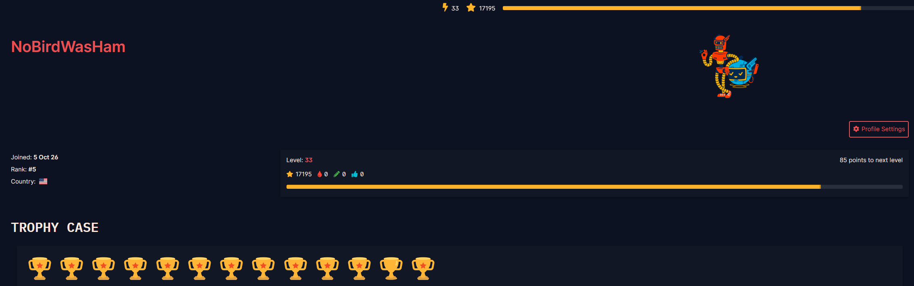

# CryptoHack — Qwen3.8 AI Learning Campaign
### 2026-10-05 → 2026-11-10 · verification audit run completed 2026-11-14 · `NoBirdWasHam` · two local models · no cloud APIs



An AI agent learned graduate-level cryptography by solving CryptoHack end-to-end — and this
repository is the complete, sourced record: **every puzzle is independent and self-contained**
(its AAR + every script we wrote), every flag is dated with honest provenance, and the
failures are documented as carefully as the wins. Built so a human or another AI can
verify, recreate, and **learn** from it.

## Where this ended
**316 / 316 on the site.** Level **34** · **17,370** stars · rank **#1** on the public
scoreboard — final state 2026-11-14, after the verification audit run (captures in
`SUPPORT/2026-11-14-verification-audit/`). Solving itself ran 2026-10-05 → 2026-11-10,
the last row (246) closing 2026-11-11 after the upstream service fix; the screenshot
above is the dated 2026-11-10 capture, and every original solve date in the ledger
stands. **231 challenge rows + 85 course rows** (316 ledger rows) from an 85-solved
baseline; **232 self-contained puzzle dirs** — every row now carries its own record
(row 260, published as `null` in the 2026-11-11 state, received its own derivation in
the audit run; appendix at the bottom).

## The three hard rows — the honest heart of this repo
| row | outcome |
|---|---|
| **246 · Additional Problems (CSC Belgium)** | **WALKED 2026-11-11 — after being the campaign's documented failure for weeks.** Attack verified locally while the container sat dead (`python:3.10`→`3.12` bump made `randint(0, float)` fatal); root cause reported upstream with byte-evidence; maintainers shipped the one-line fix; we then solved it live against the repaired service and submitted what we derived — nothing was submitted while the service was dead. Full failure-to-walk record in its AAR. |
| **237 · Sigma: Hamiltonicity 2** | SOLVED 2026-11-10 — forgery exploiting that the Fiat-Shamir hash binds the digit *stream*, not the matrix. |
| **265 · Hamiltonicity 2** | SOLVED same day — same forgery; two instances, one flag. |


The dead-service dispute in one picture: players solve (the flag string circulates — the
author's own writeup publishes it), while the TCP service answers literally nobody with
more than a 319-byte corpse. And when we reported it, the maintainer-side reply was exactly
the kind of good-faith debugging question we'd have asked:


The report landed:


Hours later the solver ran against the repaired container and the row closed **WALKED**:
`[flag — recorded in FLAGS/ctf-archive/challenge-246-cryptohack-additional_problems-csc_belgi/flag.txt]` — service-given ciphertext, self-recovered key,
submitted and verified. This row is still the thesis of this repo: document the failure
completely enough that even the other side can fix it, and let the solve finish the story.

## What you get here
Two after-action reports per puzzle — one written for humans, one optimized for AI/LLM
ingestion — plus a verification checklist where every flag row earns its check:
```
PUZZLES/<category>/<puzzle>/   AAR.md (human) + AGENT.md (AI twin) + every script we wrote
                               + README.md stub (facts, skills, concept tags) — self-contained
FLAGS/<category>/<puzzle>/     flag.txt — mirrored paths; INDEX.jsonl pairs+checksums each
TAGS/                          concept tags (rsa, fiat-shamir-forgery, …) linking the puzzles
SKILLS/                        the transferable skills this campaign produced (INDEX.yaml)
SUPPORT/                       VERIFICATION.md (per-puzzle audit checklist), platform notes,
                               runtime/models, sources, friction ledger, campaign-level
                               HUMAN.md + AGENT.md, provenance doctrine, build_repo.py
GATES.md                       the publish gates (PII sweep, author-work exclusion) and results
```
- **Verified, not asserted.** `SUPPORT/VERIFICATION.md` audits every puzzle dir (AAR present,
  method has substance, AI-twin extracted, flag sha256 matches `FLAGS/INDEX.jsonl`, PII- and
  flag-clean) and prints a pass/fail checklist; `PUZZLES/index.json` is its machine twin.
  Flag values live **only** under `FLAGS/` — the audit pass purged every value that had leaked
  into AAR prose or logs.
- **Honor system, honored.** CryptoHack grades the submitted string; our doctrine is
  stricter: flags here were self-derived or service-given only — retrieved flags were never
  submitted (SUPPORT/PROVENANCE.md). **224** flags carry values (31 restored from
  contemporaneous records, each with a dated provenance note in `FLAGS/INDEX.jsonl`);
  7 challenge rows + 83 course rows publish `null` + note instead of a fabricated value.
- **Score etiquette:** this was learning on a friendly platform — the account's scoreboard
  was cleared as a courtesy on 2026-11-13 (see `cryptohack.org/user/NoBirdWasHam/`, now
  level 1 / 0 points; the end-state screenshot above is the dated historical record).
- **Recreatable:** rerun `SUPPORT/build_repo.py` against the working corpus to re-derive this
  tree; every puzzle dir runs standalone with a plain Python venv (fpylll/PARI where noted).
- **PII-free by gate, not by promise:** zero host identity, zero third-party handles in text
  *and* images (pixelation verified by independent OCR pass), authors' files linked not hosted.

## Start reading
1. `SUPPORT/HUMAN.md` — the whole arc, plain language
2. `SUPPORT/AGENT.md` — the same facts as tagged claims (`[OBSERVED/NOT OBSERVED/UNKNOWN]`)
3. `PUZZLES/zkp/challenge-237-*` + `PUZZLES/ctf-archive/challenge-265-*` — the twin forgery
4. `PUZZLES/ctf-archive/challenge-246-*` — how a *failure* should be documented
5. `SUPPORT/FRICTION.md` — 104 wasted GPU-hours, eight days of read-only probing, and the
   probe that printed its author's verdict as its own conclusion ("That is YOU.")


---

## Appendix — verification audit run, completed 2026-11-14

The ledger's original solve dates stand: the campaign finished 2026-11-10, with the last
row (246) closing 2026-11-11 after the upstream service fix. After the owner clear of
2026-11-13, a **verification audit pass (2026-11-13/14) independently re-derived the 87
badges that did not persist** and reconciled the site against the ledger: live score
17370, solved 316 == local 316 == queue 316, unmatched zero in both directions.
Evidence lives in `SUPPORT/2026-11-14-verification-audit/` (`VERIFICATION-AUDIT-2026-11-14.md`
row table, the 106-file solve-script archive with host paths and flag values stripped to
sha256 links, the full-clear category board capture, and the final profile capture:
**Level 34 · 17,370 · rank #1**).

Rows whose published record changed during the audit:

| row | delta |
|---|---|
| **260 · Fischlin's transformation** | was: `null`, "record never written" — audit produced its **own derivation**: live-service replay of the Fischlin-OR search path (64/64 rounds); puzzle dir `PUZZLES/ctf-archive/challenge-260-…` created with AAR + artifacts. Original row-credit date (2026-10-25) stands. |
| **304 · Unbalanced (ICC Athens 2022)** | original credit 2026-11-02 stood on a credited-but-undocumented solve; the audit **independently derived it** (Durfee-Nguyen trivariate Coppersmith, rank-126 lattice, +46 b/dim margin, Bareiss-resultant extraction). Prior evidenced-negative sections remain, scoped to the bivariate route. |
| **247/13396 · Authenticator** | original solve 2026-10-28 stands; the audit **re-derived it with an independent algorithm** (rainbow tables vs the original GPU brute). The puzzle folder — previously absent from this repo due to a legacy folder misname — is now published at `PUZZLES/ctf-archive/challenge-13396-…`. |

Full delta bookkeeping: `SUPPORT/2026-11-14-verification-audit/ERRATA-UPDATE-2026-11-14.md`.
The provenance red lines are unchanged: submitted flags are exclusively self-derived or
service-given; `UNDISCLOSED = 0`.
