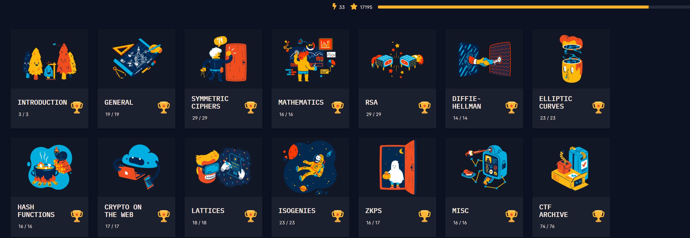

# CryptoHack — Qwen3.8 AI Learning Campaign
### 2026-10-05 → 2026-11-10 · `NoBirdWasHam` · two local models · no cloud APIs


An AI agent learned graduate-level cryptography by solving CryptoHack end-to-end — and this
repository is the complete, sourced record: **every puzzle is independent and self-contained**
(its AAR + every script we wrote), every flag is dated with honest provenance, and the
failures are documented as carefully as the wins. Built so a human or another AI can
verify, recreate, and **learn** from it.

## Where this ended
Level **33** · **17,195** stars · rank **#5** on the public scoreboard (screenshot above,
2026-11-10). **231 challenges + 85 course completions** from an 85-solved baseline.



## The three hard rows — the honest heart of this repo
| row | outcome |
|---|---|
| **246 · Additional Problems (CSC Belgium)** | **CLOSED — UNSOLVED, by design.** Attack verified ground-truth-exact against a local clone; the live container has been dead for every visitor since a 2026-09-29 image bump (`python:3.10`→`3.12` turns `randint(0, float)` into a fatal TypeError). Root-caused to one character (`/`→`//`), byte-evidence attached, fix reported. We do not submit what we did not obtain. |
| **237 · Sigma: Hamiltonicity 2** | SOLVED 2026-11-10 — forgery exploiting that the Fiat-Shamir hash binds the digit *stream*, not the matrix. |
| **265 · Hamiltonicity 2** | SOLVED same day — same forgery; two instances, one flag. |


The dead-service dispute in one picture: players solve (the flag string circulates — the
author's own writeup publishes it), while the TCP service answers literally nobody with
more than a 319-byte corpse. And when we reported it, the maintainer-side reply was exactly
the kind of good-faith debugging question we'd have asked:


## What you get here
```
PUZZLES/<category>/<puzzle>/   AAR.md + every script — self-contained, one dir per puzzle
FLAGS/<category>/<puzzle>/     flag.txt — mirrored paths; INDEX.jsonl pairs+checksums each
SKILLS/                        the transferable skills this campaign produced (INDEX.yaml)
SUPPORT/                       platform notes, runtime/models, sources, friction ledger,
                               narrative (HUMAN.md) + machine-readable claims (AGENT.md),
                               provenance doctrine, repo generator (build_repo.py)
GATES.md                       the publish gates (PII sweep, author-work exclusion) and results
```
- **Honor system, honored.** CryptoHack grades the submitted string; our doctrine is
  stricter: flags here were self-derived or service-given only — retrieved flags were never
  submitted (SUPPORT/PROVENANCE.md). 229 flags carry values; 3 redacted ledger rows publish
  `null` + note instead of a fabricated value; the closed row publishes nothing.
- **Score etiquette:** this was learning on a friendly platform — the owner clears the
  account before upload and reclears per batch (SUPPORT/BATCHES.md).
- **Recreatable:** rerun `SUPPORT/build_repo.py` against the working corpus to re-derive this
  tree; every puzzle dir runs standalone with a plain Python venv (fpylll/PARI where noted).
- **PII-free by gate, not by promise:** zero host identity, zero third-party handles in text
  *and* images (pixelation verified by independent OCR pass), authors' files linked not hosted.

## Start reading
1. `SUPPORT/HUMAN.md` — the whole arc, plain language
2. `SUPPORT/AGENT.md` — the same facts as tagged claims (`[OBSERVED/NOT OBSERVED/UNKNOWN]`)
3. `PUZZLES/zkp/challenge-237-*` + `PUZZLES/ctf-archive/challenge-265-*` — the twin forgery
4. `PUZZLES/ctf-archive/challenge-246-*` — how a *failure* should be documented
5. `SUPPORT/FRICTION.md` — 104 wasted GPU-hours, eight days of read-only probing, and the
   probe that printed its author's verdict as its own conclusion ("That is YOU.")
